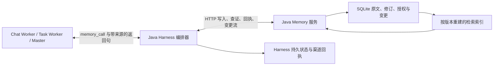

# NeuralCloud Memory v2 架构与数据契约草案

2026-11-22 · 适用于 `neuralcloud-memory` 与 `neuralcloud-harness` 两个仓库

阶段 0 和阶段 1 的 Java 实现及逐项实测记录见[首版验收报告](../acceptance/memory-v2-stage-0-1.md)。已发布的字段和响应见 [v2 OpenAPI](../../contracts/v2/openapi.json)。

Memory v2 采用 **Java 21、Maven、SQLite**，以独立 JVM 常驻运行。Harness 继续作为 Java 控制面，通过 HTTP 调用 Memory。首版交付目标是两个真实服务走通同一会话的会议改期，能回答原安排、最新安排、消息来源，以及提醒是否已有执行回执。第 6 节列出了从首版到后续阶段的交付目标。

## 1. 两个服务的职责

| 服务 | 持有的状态 | 对另一方的承诺 |
| --- | --- | --- |
| **Memory**（本仓库） | 原始事件与修订、来源依赖、授权、持久回执、变更序列、检索索引 | 唯一写记忆库的进程。在给定角色、会话和受众范围内返回有效版本、可引用范围及证据状态。原文写入与全文检索独立于模型服务。 |
| **Harness**（独立仓库） | 渠道身份、会话与轮次、Worker 实例、写入待办、已交付证据、变更消费进度、外部行动及渠道回执 | 将可信渠道身份绑定到请求，通过 Router 的 Java 写入口提交原始事件。从 Memory 的实际结果渲染自然语言，记录各 Worker 真正拿到的依据，负责下一轮更正通知和行动前复核。 |



SQL、事务和数据库迁移归 Memory。模型可以给出查询文字和行动意图，调用身份、接收会话、SQL 参数、数据访问和实际派发由两端的 Java 代码负责。Router 的 Java 写入口可以直接提交原话，0.8B 推理不在原文持久化的依赖链上。Harness 的 Epoch 换代管理一次运行的上下文，跨会话来源和修订由 Memory 持久保存。

## 2. 复用清单

基线取自 Harness `3db1894` 和拆分前的 NeuralCloud `1c44702`。两仓提交中的 Resident v1 OpenAPI 是同一个 Git 对象 `b83462d`，含九个 HTTP 路径。v1 接口里的 `SourceEventV2` 指带渠道字段的事件格式，仍属于 `/v1` 协议。[Harness v1 契约][h-openapi] · [原项目 v1 接口说明][old-http]

| 能力 | 已有资产 | v2 的处理 |
| --- | --- | --- |
| Harness 读写入口 | `ResidentMemory`、`ConversationMemory`、`MemoryCall`、`RouterMemoryWriter` 和现有审计链 | 在 Harness 原位置扩展客户端。保留 Worker/Master 只读工具 `memory_call(kind, query)` 和 Router 统一写入，给实际交付结果补上版本、来源集合和读取水位。[读客户端][h-client] · [写入口][h-writer] |
| 权威账本 | 原服务的幂等回执、原文 FTS5、修订、撤回、依赖失效、单调 `seq` | 在 Java 中移植事务语义，使用旧服务作为对照，迁移时保留既有身份和回执。Python 实现只用于历史比对，部署 v2 的两服务不依赖 Python 记忆进程。[原账本实现][old-store] |
| 检索与证据 | 显式身份索引、中文切分、关键词与向量的 RRF 排名融合、回复/时间邻近扩展、证据判断 | 复用算法基线、断言与难例。首版实现分域关键词、显式身份、事项引用和时间查询。向量融合按后续阶段移植。现有工作流部分路径先截断全局候选，Java 实现把范围限制推到各路取前 K 条之前。[原检索器][old-retrieval] · [原工作流][old-workflow] |
| 渠道与历史读取 | `recent` 按本会话回执回读，`scoped` 按会话检索。`SELF_IDENTITY` 只交付已确认称呼。QQ 私聊的 `SELF_HISTORY` 核对本人发言者及原始渠道 | 保留这些分支的可见范围和计数语义。`recent` 的回读条数单列，话题命中数仍为零。本人历史只返回经过核验的本人发言节选，第三方群消息走常规授权。[Harness 运行说明][h-run] · [本人历史来源核验][old-self] |
| 验收资产 | `ConversationMemoryTest`、`DirectMemoryCallTest`、`master-meeting-evaluation.json` 和原服务 resident 测试 | 复用相同输入和期望值。已有 HTTP 或模型挡板继续测边界，另用正式 Harness 入口和真实 Java Memory 进程验收服务联动。[Harness 直调测试][h-direct] · [会议样例][h-meet] · [原服务测试][old-tests] |

## 3. 首版数据契约

### 3.1 身份、版本与回执

| 对象 | 核心字段 | 约束 |
| --- | --- | --- |
| 调用上下文 `context` | `character_id, session_id, conversation_id, actor_id, role`，QQ 请求附经入站渠道绑定的账号与发件人 | `character_id` 绑定服务实例。`actor_id` 是发起操作的主体，`role` 为 `ROUTER / MASTER / CHAT_WORKER / TASK_WORKER / ORCHESTRATOR`。`conversation_id` 表示结果将进入的会话。Harness 从渠道和调度状态构造这些字段，Memory 用已认证服务身份和已配置的权限策略验证。 |
| 命令身份 | `source_instance, event_id` | 在一个角色主体库（`character_id`）内唯一。Harness 先持久保存事件键和完整业务载荷，重试沿用原值。Memory 比较操作类型、稳定的业务字段、作者和原文，忽略 JSON 对象字段顺序与传输追踪号。同键同内容返回原回执，同键异内容返回 `409 EVENT_ID_CONTENT_CONFLICT`。 |
| 记录引用 `RecordRef` | `record_id, revision` | `record_id` 为 64 位小写十六进制字符串。新记录沿用 v1 算法，对 `[source_instance,event_id]` 的紧凑 JSON 执行 UTF-8 编码及 SHA-256，字符串转义用 v1 对照样本验证。迁入记录保留原 ID。`revision` 为从 1 起的整数。精确引用可附 `start, end`，采用原版本正文的 Unicode 码点半开区间，Java 按码点定位中文和 emoji。 |
| 持久回执 | `status=DURABLE, record_id, revision, seq` | `seq` 是本次提交在角色主体变更流中的位置。Memory 在单一事务内写入当前记录、修订、来源、基础 FTS、变更和回执，提交成功才返回。入队、模型生成、工具尝试和渠道送达各自有独立状态。 |
| 读取快照 | `stream_id, read_seq` | `read_seq` 是读取权威数据和授权时同一快照的最高已提交序号，空库为 0。序号单调递增，消费者按大小翻页。`stream_id` 标识这条数据历史，正常重启延续，恢复到分叉的旧备份或替换数据集时更新。 |

v2 的业务时间使用带 UTC 偏移的 RFC 3339 时间字符串。`occurred_at` 来自事件，`recorded_at` 由 Memory 在提交变更时赋值，系统先后顺序以 `seq` 为准。服务归一到 UTC 比较，展示使用发言时区。“明天”相对于证据中的原发言时间解释，无法确定指代或时区时保留原话和不确定性。v1 的 Unix 秒由迁移适配器转换。

### 3.2 区分原话、事项变化与来源失效

| 内容 | 写入和引用规则 |
| --- | --- |
| 渠道观察 `observation` 与角色发言 `self_expression` | 保存原文、`occurred_at`、说话人和已核实的场合。角色发言按渠道确认送达或控制台实际写出后入账。证据证明的是谁在何处说过什么。 |
| 工具尝试 `tool_attempt`、结果 `tool_result`、送达 `delivery_receipt` | 以 `action_id` 关联对应的调用和外部回执。尝试可以证明“已请求”。回执证明的执行结果，以工具或渠道实际报告的状态为准。 |
| 主体印象 `impression` | Master 提出，Harness 通过统一写入口代交，保存作者及全部 `source_refs`。Worker 的判断可以作为本轮材料。印象、转述、重复摘要分别保留归属，同一原始来源只计一次。 |
| 明确的事项更新 | 新发言取得新 `record_id`。当同一事项及其更改关系有明确依据时，可随观察提交 `assertion`，含 `subject_id, predicate, value, effective_at` 和可选 `supersedes_ref`。会议使用 `predicate=scheduled_for`，`value` 为开会时间。指向旧安排的关系不会撤销那条历史发言。对象或替代关系不确定时保留各自陈述并报告证据不足或冲突。 |
| 原消息编辑或撤回 | `corrections` 请求指定 `record_id, expected_revision, operation, reason`。`operation` 为 `REPLACE`（附新正文）或 `RETRACT`。Memory 校验操作权限和预期版本，追加修订，更新当前状态、索引和变更流。旧修订保留审计归属。 |
| 带来源的派生内容 | 每个可发布单元保存全部 `source_refs`。Memory 在发布事务内逐一复核来源版本、状态及派生权限，过期返回 `409 SOURCE_CHANGED`，重新提炼使用新版本。源修订后，依赖项可在自身 `revision` 不变时转为 `SOURCE_CHANGED`。 |

**会议样例。** 小林周三在项目群发“例会定在周五 15 点”，周四回复原消息“例会改到周六 10 点”。原文留两条。假设新安排从周四通知时生效、消息周五才补录，则“周六 10 点”是会议时间，周四是安排的生效时间，周五是系统得知时间。首版对明确的事项关系分别保存业务有效区间 `[valid_from, valid_to)` 和系统已知区间 `[known_from_seq, known_to_seq)`，末端可开放。按 `as_of_valid` 查当时的安排，按 `as_of_known_seq` 还原当时已知的证据，两者可组合。补录或修订追加系统历史，重建索引沿用权威提交序号。提醒清单有无更新单独检查 `action_id` 的执行结果。

### 3.3 权限与交付

- **按目的读。** 普通 `HISTORY` 以接收会话为范围。`SELF_IDENTITY` 只交付该账号经确认的称呼。`SELF_HISTORY` 仅对可信 QQ 私聊入站的本人开放，按原作者、允许的原始渠道、可见性和本轮之前的时间上限筛选。`privacy=private` 只描述隐私等级，展示“私聊”或群名需要渠道依据。
- **先确定候选集合，再排名。** 身份、FTS、时间、向量和图的每一跳均应用当前受众约束。回读原文时逐条校验，缓存键包含受众、查询条件及权威水位。使用历史时间查询也须满足当前披露权限。多来源卡片的一段文字，仅在该受众能读且可在此引用其全部必要来源时交付，也可以从可见来源单独生成另一段。相同规则覆盖热索引标题、样板句和转交给另一 Worker 的材料。
- **按交付项保留引用。** Memory 返回结构化正文、证据性质、原发言场合和本次可引用范围。Harness 渲染为“小林在项目群里说，例会改到周六 10 点。这条消息可在本群引用。”旧数据缺少的场合字段省略。技术标识进入审计与读取登记。Master 遵循当前任务的接收范围。
- **通用跨会话授权在第二阶段开放。** 授权对象为 `grant_id, source_ref, target_conversation_id, use, grantor, reason, status`。`use` 取 `READ` 或 `CITE`，`CITE` 包含在指定会话读和引用的权限。授予者须有经配置的转授权权限，Memory 记录经认证的决策主体。授权精确绑定版本，撤回、更正或撤销使原授权退出有效集。此前获准阅读的 Worker 收到“原依据已失效”，只有新版本获准后才接收新正文。

## 4. 两服务间的 HTTP 契约

本仓库负责发布 v2 OpenAPI 和版本化 JSON 示例，Harness 按发布版本测试客户端。现有 Harness 的 `memoryConfig` 指向含 `endpoint, characterId, accessTokenEnv` 和可选 `recallMode` 的文件。拟增加 `apiVersion=2` 显式选用新服务，省略时保留现有 v1 客户端行为。v2 联调使用回环 HTTP 地址和 Bearer 服务凭据。v1 旧客户端连原服务，v2 客户端连 Java Memory，相互独立选址。模型工具里的 `kind, query` 可保持原形。[现有配置校验][h-config] · [Harness 启动与握手][h-start]

Harness 当前的 `ResidentMemory.Match` 只含 `recordId, occurredAt, message`，按 ID 的 `read` 返回 `Optional<String>`。v2 客户端须将同一响应里的 `ref, source_refs, stream_id, read_seq` 随材料一直传到编排器。`ConversationMemory` 裁剪后登记的版本取自这次交付，后续重读单独登记。[Harness 读取结果类型][h-client]

| 操作 | 请求与成功返回 | 阶段 |
| --- | --- | --- |
| `GET /v2/health` | 返回 `api_major=2, status=TEXT_READY, character_id, stream_id, head_seq, capabilities`。角色、协议和本次联调所需能力均匹配后 Harness 开放记忆入口。可选索引另报其就绪状态和消费水位。 | 0 |
| `POST /v2/ingest` | `context`、命令身份、`kind, occurred_at, content`、原始场合和已取得的渠道元数据。工具链带 `action_id`，明确的事项更新可附 `assertion`。返回持久回执。 | 1 |
| `POST /v2/corrections` | `context`、命令身份、目标 ID、预期版本、操作和理由。Memory 校验发言者或操作主体的修改权限，返回新版本的持久回执。原 v1 路径同样使用复数 `corrections`。 | 1 |
| `POST /v2/candidates` | `context`、命令身份、`kind, content, source_refs` 及作者，首版接受 `impression` 和 `summary`。每项至少引用一个来源，按 `(record_id, revision)` 去重。全部依赖校验通过后，返回以该派生项为对象的持久回执。 | 1 |
| `GET /v2/receipts` | 以 `source_instance, event_id` 查询本写入方的提交结果，返回原持久回执或 `status=NOT_FOUND`。超时后先对账，需重提时使用同一命令身份。 | 1 |
| `POST /v2/recall` | `context, kind, query, profile, limit`，可附 `subject_id, as_of_valid, as_of_known_seq, before`。`profile=QUICK` 交付受预算约束的证据，`THINKING` 允许主动查证并按能力扩大候选。返回 `stream_id, read_seq, assessment, items`。普通历史与 `SELF_HISTORY` 查询通过 `before` 排除本轮及其后发言，Harness 从入站事件绑定上界。 | 1 基础检索，3 增强 |
| `POST /v2/read` | `context, targets[]`，每项目标含 `record_id`，可指定 `revision` 读取获准的历史版本，省略时取当前版。可选 `start, length` 限制原文码点窗口。按目标返回实际 `ref, status` 及有权查看的原文，共用一个 `read_seq` 和 `stream_id`。Harness 用同一接口复核行动依据。 | 1 |
| `GET /v2/changes` | 仅供经授权的控制面消费者。必传 `stream_id, after`，可传 `through, limit`。按 `seq` 升序返回 `(after, through]` 内的 `items[{seq,op,record_id,revision}]`、`next_after` 和 `through`。首次省略 `through` 时由服务冻结为当前 `head_seq`。最后一页推进到 `through`，正常重启可续读。变更信封不含正文。 | 1 |
| `POST /v2/visibility-grants` 和 `POST /v2/visibility-grants/{grant_id}/revoke` | 授予请求提交 `source_ref, target_conversation_id, use, reason`，撤销请求提交理由。两者均带 `context` 和命令身份，记入授权决策和变更流，回执包含 `grant_id`、受影响的 `record_id, revision` 及 `seq`。 | 2 |

历史查询的 `query` 为具体话题，最多 256 个 Unicode 码点，`SELF_IDENTITY` 传空字符串。普通召回 `limit` 为 1–50，`SELF_HISTORY` 为 1–16，Harness 沿用一次最多 4 条本人节选、每条最多 2048 个码点的交付范围。原文窗口 `length` 为 1–16384 个码点，变更分页 `limit` 为 1–500。`changes` 的 `op` 取 `INGEST / CANDIDATE / REPLACE / RETRACT / SOURCE_CHANGED / ASSERTION_UPDATED / GRANT / REVOKE`。`ASSERTION_UPDATED` 通知曾读到旧安排的接收者复核同一事项的当前状态。一次命令可产生多条变更，回执的 `seq` 取该事务最后一条。授权变更指向受影响记录，Harness 通过本地依赖定位接收者。

**返回与错误。** `assessment.state` 使用 `DIRECT / INFERRED / RELATED / CONFLICT / INCOMPLETE / NOT_FOUND`，另含 `sufficient` 和 `absence_confirmed=false`。请求需要的证据因索引积压或查询截止时间而缺失时，返回 `INCOMPLETE` 并交代覆盖范围。当前有效正文只随 `ONLINE` 交付。对曾经登记且仍可知道其状态的项，可返回 `RETRACTED / SOURCE_CHANGED / ARCHIVED_OFFLINE / INACTIVE` 和空正文。指定记录不可见与查无此记录对接收者均表现为 `NOT_FOUND`。未认证返回 `401`，无操作权限返回 `403`，无效字段返回 `422` 并标明字段。命令冲突、版本冲突、来源失效和流更换以 `409` 携带可区分的 `code`。存储不可用返回 `503`。检索失败和成功零命中用不同结果表达。

**`POST /v2/recall` 示例。** 下例为同会话请求及其响应。`ref` 是返回项自身的版本，`source_refs` 是支撑这段文字的原始版本。直接引语的两者相同。Harness 可以裁剪未选中的项，再把实际进入模型输入的项及其依赖登记。

```json
{
  "context": {
    "character_id": "misty-dev",
    "session_id": "session-demo",
    "conversation_id": "group:demo",
    "actor_id": "master-main",
    "role": "MASTER"
  },
  "kind": "HISTORY",
  "query": "例会最终定在什么时候？",
  "before": "2026-11-20T09:05:00+08:00",
  "profile": "QUICK",
  "limit": 3
}
```

```json
{
  "stream_id": "95fe56c7-0e74-4509-896d-e78ae6d5b42a",
  "read_seq": 42,
  "assessment": {"state": "DIRECT", "sufficient": true, "absence_confirmed": false},
  "items": [{
    "ref": {"record_id": "03faf212d0d98f6e5b6932e3afc1f338dfca440218498cfb1c0d304948504e02", "revision": 1},
    "source_refs": [{"record_id": "03faf212d0d98f6e5b6932e3afc1f338dfca440218498cfb1c0d304948504e02", "revision": 1}],
    "status": "ONLINE",
    "kind": "observation",
    "basis": "direct",
    "view": "L1",
    "text": "例会改到周六 10 点。",
    "occurred_at": "2026-11-19T10:00:00+08:00",
    "speaker": "小林",
    "source_venue": "项目群",
    "citation_scope": "group:demo"
  }]
}
```

## 5. 提交、交付与恢复

### 5.1 入账和派生

首版用一个 SQLite 文件容纳必须同事务改变的权威数据，由 Java 服务持有唯一写者，使用 JDBC、WAL、完整同步提交和 FTS5。原文、授权及发布状态按角色主体隔离。逻辑上分开以下数据。

| 数据归属 | 建议的逻辑表及更新单位 |
| --- | --- |
| Memory 的权威事务 | `records` 保存当前修订和状态，`revisions` 追加原文版本，`source_refs` 保存派生项与来源双方的版本，`receipts` 与 `changes` 同提交。当前全文索引随原文一起写入或摘除。为来源 ID 建反向索引以传播失效。显式事项关系保存生效时间、系统序号和依据。阶段 2 的 `visibility_grants` 与授权变更同事务提交。 |
| Memory 的可重建数据 | 事件单元、时态事实、回复/时间关系边、向量、分域卡片和热索引均记录来源和生成版本。后台任务按变更水位幂等重放。独立索引文件只提供候选，发布时校验来源，交付时在权威快照复核有效性和权限。异步积压期间仍可查已提交的原文。 |
| Harness 的持久状态 | 写入待办以命令身份重试。读取依赖以 `worker_instance_id, input_id, record_id, revision` 定位并保存 `stream_id, read_seq`。`pending_corrections` 及消费者检查点归 Harness 自己的事务管理。既有审计中保留 `memory_durable` 和 `memory_call_result` 的关联。 |

入站写入得到 `DURABLE` 后，Harness 才把该发言作为已提交证据交给下一步。外部回复已经送达、随后记忆写入失败时，Harness 按原 `action_id` 核对渠道结果，仅重试记忆写入。即使后台仍保有旧向量或旧摘要，新的当前态读取也只能交付权威快照中有依据的内容。[现有写入与送达顺序][h-writer]

### 5.2 读取登记与更正竞态

1. **组装实际输入。** Harness 取得快照 `S=read_seq`，渲染并裁剪后，为要送入模型的材料分配 `input_id`。在本地事务中保存这份输入及最终选中项、其必要来源、接收 Worker、会话和 S。准备交付与实际交付分别留状态，重启可按同一输入标识续办。自动预召回、主动取证和原文展开都走这一步。
2. **补登记空档。** 读取登记与消费者检查点更新在 Harness 的持久库内串行化。如果登记时本地游标 C 已超过 S，同事务记下一项 `(S,C]` 补查任务。消费者每页将受影响的登记写入待通知区，再在同一事务推进 C。这样，更正先于登记或登记先于更正，两种顺序都有可靠的处理路径。
3. **在下一轮首个输入前刷新。** Harness 取 Memory 当前水位 H，处理到 H 并完成该 Worker 的补查，然后用当前受众上下文批量重读。多次更正合并为最新可见结果。检查依据状态、版本和权限，授权变更即使版本不变也会触发重读。撤权时从本轮重建的上下文及可复用前缀中排除旧正文。H 之后提交的更正进入后续轮次，尚未提交的动作仍按第 4 步复核。已经流式交付的上一轮以实际发送情况记账。
4. **在外部动作提交前核对。** Harness 保存并复核行动的证据集、当前权限和 `action_id`。依赖过期则返回重新取证，Memory 不可用则挂起依赖该证据的行动。复核与外部渠道分属不同事务，已发出的动作凭渠道幂等键和实际回执恢复，重新取证不会自动重发。

Worker 的登记至少保留到实例结束。未完任务交接时，新实例从持久的任务依赖重新授权、重读和绑定。消费者遇到 `stream_id` 改变或游标超出新历史时停止推进，按新库快照重新核对活跃依赖，再记录新检查点。[跨会话更正修订稿][h-revisions]

### 5.3 启停与迁移

- **启动。** Memory 先校验配置、数据目录、写者锁、模式版本和 FTS5 可用性，再开放 `/v2/health`。Harness 的 `ConsoleMain` 从 `memoryConfig` 读取端点和凭据，核对角色、协议及能力。启用 `scoped` QQ 私聊时，本人身份和本人历史能力也须可用。启动器可由 Harness 扩展为同时管理两个服务，仅回收自己拉起的进程。[现有启动器与参数][h-run]
- **故障与重启。** Memory 不可用时 Harness 保留待写事件和游标，依赖查证的步骤报告不可用。Memory 重启后先对账再重试。Harness 重启从自己的已提交游标和待处理区恢复。正常停机先让 Harness 停接新轮、持久化待办，再关闭 Memory。集成测试分别重启每一端。
- **切换旧数据。** 先以一致性快照导入独立目录，保留记录 ID、修订、回执、已提交序号、撤回/离线状态和原始载荷。v1 幂等比对沿用旧规范化结果，保留哈希和历史回执。旧 `source_ids` 无法证明读取版本时标记依据未核实，缺失场合时按可证实范围披露。比对记录数、修订、回执、哈希及抽样回读，再重建索引。
- **切换与回退。** 记录旧服务最后水位，暂停其写入口、排清或转移 Harness 待办，补齐到该水位后切换端点和协议。第一笔 v2 新写入前可直接切回旧快照。此后若须回退，先核对新增命令及回执是否能在目标恢复，处理 v1 无法表达的授权与派生项后再开放写入。两端同时写一份账本会破坏这一恢复边界。

## 6. 分阶段交付与验收

**阶段 0 和 1 构成首版。** 阶段 2 开放通用跨会话授权与多 Worker 更正。阶段 3 和 4 各自用独立回放决定是否启用。下表给出各阶段可以观察和判定的结果。

| 阶段 | 交付 | 怎样判定通过 |
| --- | --- | --- |
| **0 · Java 服务与契约基线** | Memory 产出可独立启动的 Java JAR、隔离数据目录、健康端点、v2 OpenAPI 和样例。Harness 增加显式 v2 配置和能力核对。冻结 v1 回放输入和期望。 | 从两个独立 JVM 观察到同一 `character_id, stream_id` 和匹配的协议。错误凭据、角色不符、协议不符和缺失必需能力得到明确失败。Memory 正常重启继承流身份。比对旧样本的记录 ID、回执、中文和 emoji 摘录边界。 |
| **1 · 同会话可用首版** | 入账、查回执、编辑/撤回、派生写入复核、分域基础检索、显式事项时间线、实际读取登记及单 Worker 下一轮刷新。保持 Harness 三种读取目的的既有行为。 | 经 Harness 正式入口输入两次发言，Memory 返回两个不同的记录 ID。查原安排得到周五 15 点，查现安排得到周六 10 点，结果引用小林在该群发出的相应原文。仅有工具尝试时提醒状态为未知，加入匹配的执行回执后才更新判断。重放同键事件只有一笔提交。原文编辑后用旧版本生成的候选被拒，已发布摘要停止作为当前证据。大量其他会话相似文本不挤掉本群合法命中。 |
| **2 · 授权与更正传播** | 版本绑定的 `visibility_grants`、跨 Worker 订阅与补查、授权撤销和输入重建。按目标受众渲染卡片、通知与原文窗口。 | 以项目群、获准私聊、未获准私聊和两个活跃 Worker 联调。授权前后分别检查真实模型输入。群内时间可引用，私聊提供的改期原因不出现在群内结果、标题或缓存中。覆盖更正已消费才登记、提交待通知时进程中断、摘要版本不变但来源失效、撤权后旧前缀仍含原话四种顺序。逐例验证下轮首个输入和行动依据，两个服务独立重启后零漏通知、零重复渠道动作。 |
| **3 · 扩展检索与时态推理** | 从同会话事件单元 `MemCell` 开始，按需加入指代与绝对时间、限期状态 `Foresight`、双时态事实、1–2 跳关系、向量与 RRF、`THINKING` 精排。Push 可由 0.8B Router 做 `SKIP/RECALL`，主动 Pull 继续可用。 | 冻结一组脱敏中文多轮对话，标注受众、查询时点和正确 `record_id@revision`。固定同一候选/上下文预算，逐项打开组件与阶段 1 基线比较。交付按问题类型的 Recall@5、来源归属正确率、过期证据率、P95 检索延迟和聊天首字延迟。仅启用能改善预先选定难例、通过正确性门槛且满足本机延迟预算的组件。 |
| **4 · 分域卡片、热索引与离线整理** | 按受众构建人物/事项卡，L0 给目录提示，L1 给带来源摘要，L2 读取原文。热索引优先放未决承诺、期限和卡片指针，按实际模型 token 设上限。P3 空闲任务从上次水位盘点、收集增量、核对并整理、清理过期引用。Master 可据新证据修订印象。 | 比较开关整理前后的同一批长期任务。检查常驻 token 是否始终在预算内，错误印象能否依原文修订、已到期的临时状态是否退出当前回答、后台积压或中断时原文查证是否可用。重复摘要只算一个来源，外部聊天里的指令只保留为发言内容。记录整理耗时及同卡前台延迟，再决定触发水位和频率。 |

**首版联调取证。** 运行方为两个服务分别设置临时数据目录，从 Harness `ConsoleMain` 的会话入口提交消息。模型和渠道可使用可控端点，Memory 必须走真实进程、网络和持久存储。保留对应的 `router_memory_write → memory_durable`、`memory_call → memory_recall → memory_call_result`、实际首个模型输入、Memory 修订及 `seq`、工具/渠道回执。逐项比较 `record_id@revision` 与正文。复用 `paired-saturday`、`withdrawn-correction`、`attempt-without-receipt`、`private-evidence` 等既有样例，再补晚到派生、登记竞态和服务重启。用例中的越权正文、错误现行版本和重复副作用均要求为零。[会议评测原始用例][h-meet] · [会话记忆回归测试][h-conv-test]

**资源和产品决策。** 联调按现有 0.8B Router 和 27B Master 配置记录，目标 9B 单独复测。检索收益和资源预算在固定数据规模、模型版本、并发与冷热缓存条件下报告。阶段 2 启用前须确定实际渠道中谁可授予或撤销引用权，再将该规则写入服务策略和双端用例。阶段 3、4 的精排开关、热索引 token 上限和整理间隔以本机验收数据确定。

[h-openapi]: https://github.com/QiuYuAkiGO/neuralcloud-harness/blob/3db18942d34c963ec35dcd774b05363d4a2cfb25/contracts/resident/v1/openapi.v1.json
[h-client]: https://github.com/QiuYuAkiGO/neuralcloud-harness/blob/3db18942d34c963ec35dcd774b05363d4a2cfb25/java/src/main/java/neuralcloud/controlplane/memory/ResidentMemory.java
[h-writer]: https://github.com/QiuYuAkiGO/neuralcloud-harness/blob/3db18942d34c963ec35dcd774b05363d4a2cfb25/java/src/main/java/neuralcloud/controlplane/router/RouterMemoryWriter.java
[h-run]: https://github.com/QiuYuAkiGO/neuralcloud-harness/blob/3db18942d34c963ec35dcd774b05363d4a2cfb25/java/README.md
[h-config]: https://github.com/QiuYuAkiGO/neuralcloud-harness/blob/3db18942d34c963ec35dcd774b05363d4a2cfb25/java/src/main/java/neuralcloud/controlplane/app/MemoryConfig.java
[h-start]: https://github.com/QiuYuAkiGO/neuralcloud-harness/blob/3db18942d34c963ec35dcd774b05363d4a2cfb25/java/src/main/java/neuralcloud/controlplane/app/ConsoleMain.java
[h-revisions]: https://github.com/QiuYuAkiGO/neuralcloud-harness/blob/3db18942d34c963ec35dcd774b05363d4a2cfb25/docs/proposals/master-worker-design-revisions-20261121.md
[h-direct]: https://github.com/QiuYuAkiGO/neuralcloud-harness/blob/3db18942d34c963ec35dcd774b05363d4a2cfb25/java/src/test/java/neuralcloud/controlplane/app/DirectMemoryCallTest.java
[h-conv-test]: https://github.com/QiuYuAkiGO/neuralcloud-harness/blob/3db18942d34c963ec35dcd774b05363d4a2cfb25/java/src/test/java/neuralcloud/controlplane/memory/ConversationMemoryTest.java
[h-meet]: https://github.com/QiuYuAkiGO/neuralcloud-harness/blob/3db18942d34c963ec35dcd774b05363d4a2cfb25/java/src/test/resources/fixtures/master-meeting-evaluation.json
[old-http]: https://github.com/QiuYuAkiGO/NeuralCloud/blob/1c44702af88ec991f3813f18fbf8cc1358dadc9e/docs/interfaces.md
[old-store]: https://github.com/QiuYuAkiGO/NeuralCloud/blob/1c44702af88ec991f3813f18fbf8cc1358dadc9e/src/neuralcloud/storage.py
[old-retrieval]: https://github.com/QiuYuAkiGO/NeuralCloud/blob/1c44702af88ec991f3813f18fbf8cc1358dadc9e/src/neuralcloud/retrieval.py
[old-workflow]: https://github.com/QiuYuAkiGO/NeuralCloud/blob/1c44702af88ec991f3813f18fbf8cc1358dadc9e/src/neuralcloud/workflow.py
[old-self]: https://github.com/QiuYuAkiGO/NeuralCloud/blob/1c44702af88ec991f3813f18fbf8cc1358dadc9e/src/neuralcloud/self_history.py
[old-tests]: https://github.com/QiuYuAkiGO/NeuralCloud/tree/1c44702af88ec991f3813f18fbf8cc1358dadc9e/tests/resident
